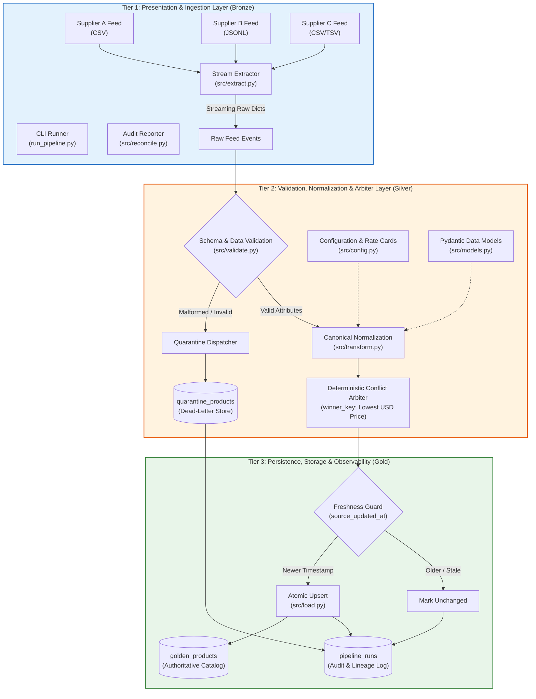

# 3-Tier Architecture: Multi-Supplier Golden Product Catalog

This document details the architectural foundation of the **Multi-Supplier Golden Product Catalog** data engineering pipeline. The solution implements a dual 3-tier architecture:

1. **System Software Architecture**: Separation of Presentation & Ingestion (Tier 1), Domain Business Logic & Transformation (Tier 2), and Storage & Persistence (Tier 3).
2. **Data Lakehouse Medallion Architecture**: Progression from Raw Multi-Format Feeds (**Bronze**), Cleansed & Quarantined Intermediate Records (**Silver**), to Authoritative Golden Catalog & Operational Audit (**Gold**).

---

## 1. High-Level Architecture Diagram



---

## 2. Tier 1: Presentation & Ingestion Layer (Bronze)

The **Ingestion Layer** is responsible for interfacing with the execution environment, parsing CLI arguments, reading heterogeneous raw vendor feeds in streaming mode, and isolating row-level extraction errors without halting execution.

### Key Components & Responsibilities

| Component | File Path | Core Functionality |
|---|---|---|
| **CLI Runner** | [`run_pipeline.py`](file:///c:/CandidateWorkspace/hackathon/run_pipeline.py) | CLI entrypoint with `--input-dir`, `--db`, `--categories`, and `--report` flags. |
| **Stream Extractor** | [`src/extract.py`](file:///c:/CandidateWorkspace/hackathon/src/extract.py) | Memory-efficient streaming generator (`iter_feed`) reading feeds row-by-row. |
| **Delimiter Sniffer** | [`src/extract.py`](file:///c:/CandidateWorkspace/hackathon/src/extract.py) | `detect_delimiter()` automatically identifies `,` vs `\t` delimiters for CSV/TSV feeds. |
| **Terminal Auditor** | [`src/reconcile.py`](file:///c:/CandidateWorkspace/hackathon/src/reconcile.py) | Terminal dashboard generating source-to-target reconciliation and data balance tables. |

### Technical Highlights
- **Resilient Row-Level Trapping**: Rather than terminating when encountering corrupt inputs (such as broken JSON lines like `{"item_id": BROKEN JSON`), `iter_feed()` catches parsing exceptions per line and yields `({'_raw_line': ...}, 'MALFORMED_JSON')`.
- **CSV Header Verification**: Before processing rows, CSV feeds verify mandatory columns (`REQUIRED_HEADERS`). Any column mismatch immediately yields a `MISSING_COLUMNS` event.
- **Memory Efficiency**: Feeds are consumed via Python generators, guaranteeing $O(1)$ memory consumption regardless of input file size.

---

## 3. Tier 2: Validation, Normalization & Conflict Arbiter (Silver)

The **Transformation Layer** contains pure business domain logic, independent of file I/O or database drivers. It enforces data quality standards, performs high-precision currency conversions, standardizes product taxonomy, and resolves multi-supplier vendor conflicts.

### Key Components & Responsibilities

| Component | File Path | Core Functionality |
|---|---|---|
| **Pydantic Schemas** | [`src/models.py`](file:///c:/CandidateWorkspace/hackathon/src/models.py) | Typed validation schemas for raw vendor feeds, normalized entities, and target tables. |
| **Data Validators** | [`src/validate.py`](file:///c:/CandidateWorkspace/hackathon/src/validate.py) | GS1 modulo-10 GTIN check-digit calculation, ISO-8601 UTC timestamp parser, price/stock validation. |
| **Canonical Normalizer** | [`src/transform.py`](file:///c:/CandidateWorkspace/hackathon/src/transform.py) | Converts currencies, maps categories, collapses whitespace, and generates stable product keys. |
| **Conflict Arbiter** | [`src/transform.py`](file:///c:/CandidateWorkspace/hackathon/src/transform.py) | Multi-tier deterministic tie-breaker tuple (`winner_key`) ranking competing offers. |
| **Configuration** | [`src/config.py`](file:///c:/CandidateWorkspace/hackathon/src/config.py) | Fixed currency rate card (`RATES`), supplier priority ranks (`PRIORITY`), and file mappings. |

### Data Quality & Business Rules

#### 1. GS1 Barcode Check-Digit Algorithm
Barcodes are validated against the GS1 standard using alternating $3\times$ and $1\times$ weights:
$$\text{Check Digit} = \left(10 - \left(\sum_{i=1}^{n-1} d_i \times w_i \pmod{10}\right)\right) \pmod{10}$$
Supported lengths: GTIN-8, GTIN-12 (UPC-A), GTIN-13 (EAN-13), and GTIN-14. Valid barcodes are zero-padded to 14 digits. If a product lacks a barcode, identity falls back deterministically to `SKU:{supplier_id}:{sku}`.

#### 2. High-Precision Currency Conversion
To eliminate IEEE-754 floating-point drift, all financial math uses Python’s `Decimal` module with explicit `ROUND_HALF_UP` quantization:
$$\text{Price}_{\text{USD}} = \text{Decimal}(\text{Price}_{\text{Local}}) \times \text{Rate}_{\text{Currency}}$$
- Rates: $\text{USD} = 1.00, \quad \text{EUR} = 1.08, \quad \text{GBP} = 1.27$.
- Supplier B’s integer `amount_cents` is divided by $100$ before conversion.

#### 3. Category Taxonomy Normalization
Supplier taxonomy codes (`CAT_402`, `"Laptops"`, `"Electronics > Computers"`) are mapped case-insensitively against [lookup_categories.csv](file:///c:/CandidateWorkspace/hackathon/config/lookup_categories.csv). Unmapped codes safely default to `"Uncategorized"`.

#### 4. Deterministic Conflict Resolution (The Tie-Breaker)
When competing vendors offer the identical physical product (matched via GTIN-14), the winner is selected via the deterministic tuple:
```python
winner_key = (
    Decimal(row['price_usd']),                                     # 1. Lowest USD price
    -row['stock_quantity'],                                        # 2. Higher available stock
    PRIORITY[row['winning_supplier_id']],                          # 3. Supplier Priority (A > B > C)
    -datetime.fromisoformat(row['source_updated_at']).timestamp(), # 4. Most recent update
    row['source_record_hash']                                      # 5. Stable hash tie-breaker
)
```

---

## 4. Tier 3: Persistence, Storage & Observability (Gold)

The **Storage Layer** persists the curated, authoritative catalog and provides operational observability, lineage tracking, and strict idempotent guarantees.

### Key Components & Responsibilities

| Component | File Path | Core Functionality |
|---|---|---|
| **Database Loader** | [`src/load.py`](file:///c:/CandidateWorkspace/hackathon/src/load.py) | Manages atomic transactions, batch quarantine inserts, idempotent upserts, and run metrics. |
| **Orchestrator** | [`src/pipeline.py`](file:///c:/CandidateWorkspace/hackathon/src/pipeline.py) | Coordinates the end-to-end lifecycle, handles rollbacks, and guarantees connection closing. |
| **Catalog DDL** | [`sql/schema.sql`](file:///c:/CandidateWorkspace/hackathon/sql/schema.sql) | DDL schemas, check constraints, and secondary indexes for the 3 target tables. |
| **Operational SQL** | [`sql/analytics.sql`](file:///c:/CandidateWorkspace/hackathon/sql/analytics.sql) | 6 analytical queries for reconciliation, category pricing, quarantine breakdown, and lineage. |

### Target Storage Tables

```text
┌────────────────────────────────────────────────────────────────────────┐
│                        golden_products (Target Catalog)                │
├────────────────────────────────────────────────────────────────────────┤
│ master_product_id (PK) │ SHA-256 derived 32-character hex product ID   │
│ gtin                   │ Standardized 14-digit universal barcode       │
│ standard_title         │ Sanitized, whitespace-collapsed title         │
│ standard_category      │ Normalized taxonomy or 'Uncategorized'        │
│ price_usd              │ Precise USD decimal price string              │
│ stock_quantity         │ Non-negative integer inventory count          │
│ winning_supplier_id    │ Supplier who won conflict resolution          │
│ source_sku             │ Vendor native SKU                             │
│ source_record_hash     │ SHA-256 hash of original raw payload          │
│ ingestion_run_id       │ UUID linking to the pipeline execution run    │
│ source_updated_at      │ ISO-8601 UTC timestamp from supplier source   │
│ last_updated_at        │ ISO-8601 UTC timestamp of catalog write       │
│ source_file / batch_id │ Vendor file and batch lineage identifiers     │
└────────────────────────────────────────────────────────────────────────┘

┌────────────────────────────────────────────────────────────────────────┐
│                     quarantine_products (Dead-Letter Table)            │
├────────────────────────────────────────────────────────────────────────┤
│ rejection_id (PK)      │ Unique UUID for the rejection event           │
│ supplier_id            │ Source vendor ID                              │
│ raw_record             │ Original raw payload (JSON string)            │
│ rejection_reason       │ Explicit failure code (e.g. NULL_PRICE)       │
│ ingestion_run_id       │ Ingestion run during which failure occurred   │
│ failed_at              │ ISO-8601 UTC failure timestamp                │
└────────────────────────────────────────────────────────────────────────┘

┌────────────────────────────────────────────────────────────────────────┐
│                        pipeline_runs (Operational Audit)               │
├────────────────────────────────────────────────────────────────────────┤
│ run_id (PK)            │ Unique execution UUID                         │
│ started_at / completed │ Execution duration timestamps                 │
│ status                 │ SUCCESS / PARTIAL_SUCCESS / FAILED            │
│ records_read_total     │ Total records read across all feeds           │
│ records_published      │ New or updated catalog records in this run    │
│ records_rejected       │ Quarantined dead-letter count                 │
│ records_deduplicated   │ Competing/duplicate records resolved          │
│ records_unchanged      │ Identical/stale records skipped on rerun      │
│ error_summary          │ JSON failure counts by category               │
└────────────────────────────────────────────────────────────────────────┘
```

### Idempotency & Mathematical Row Conservation

1. **Idempotency Guarantee**:
   Re-running the pipeline on identical input data writes `records_published = 0`, marks records as `records_unchanged = N`, and maintains identical catalog row counts with zero duplicated rows.
2. **Freshness Protection**:
   Incoming records whose `source_updated_at` is older than the existing catalog entry are skipped, preventing out-of-order data corruption.
3. **Conservation Equation**:
   Every run enforces exact mathematical balance verified to `diff = 0`:
   $$\text{records\_read\_total} = \text{records\_published} + \text{records\_rejected} + \text{records\_deduplicated} + \text{records\_unchanged}$$

---

## 5. Summary Mapping: Files to Tiers

```text
+-----------------------------------------------------------------------------------------+
| TIER 1: INGESTION & PRESENTATION                                                        |
|   run_pipeline.py               CLI entrypoint and argument parser                      |
|   src/extract.py                Streaming CSV/TSV & JSONL reader with syntax error trap |
|   src/reconcile.py              Audit reporting & reconciliation table generator        |
+-----------------------------------------------------------------------------------------+
| TIER 2: BUSINESS LOGIC & TRANSFORMATION                                                 |
|   src/config.py                 Static currency rates, supplier priorities, constants   |
|   src/models.py                 Pydantic v2 schemas for feeds and catalog records       |
|   src/validate.py               GS1 barcode check-digit algorithm & nullability checks  |
|   src/transform.py              Currency math, category lookup, conflict arbiter        |
+-----------------------------------------------------------------------------------------+
| TIER 3: PERSISTENCE & STORAGE                                                           |
|   src/load.py                   SQLite transactional upsert, quarantine, and audit log  |
|   src/pipeline.py               Pipeline orchestrator & connection lifecycle manager    |
|   sql/schema.sql                Target DDL, table constraints, and performance indexes  |
|   sql/analytics.sql             6 operational analytics and reconciliation queries      |
+-----------------------------------------------------------------------------------------+
```
